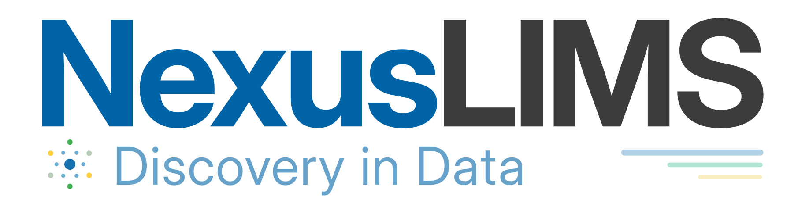

```{toctree}
:maxdepth: 2
:hidden:

Home <self>
Overview <frontend_guide/overview>
Deployment <frontend_guide/production>
Administration <frontend_guide/administration>
Development <frontend_guide/development>
Changelog <frontend_guide/changelog>
```

# NexusLIMS CDCS



[NexusLIMS CDCS](https://github.com/datasophos/NexusLIMS-CDCS) is the frontend for NexusLIMS.
It provides a web-based platform for searching, visualizing, and managing the experimental records
generated by the [NexusLIMS backend](https://datasophos.github.io/NexusLIMS).

Prefer to explore for yourself rather than reading documentation?

```{button-link} https://nexuslims-demo.datasophos.co
:color: primary
:shadow:
:align: center

Try the Live Demo →
```

```{admonition} Looking for the main NexusLIMS documentation?
:class: tip

Heads up! This documentation site is for the frontend web application bundled with [NexusLIMS](https://datasophos.co/nexuslims).
If you are interested in the main NexusLIMS application that extracts metadata and builds experimental records, please see the [main documentation site](https://datasophos.github.io/NexusLIMS).
```

## Key Features

- **Search and explore records** using full-text and structured queries.
- **Visualize experimental data** with previews, metadata, and downloadable files.
- **Curate datasets** with descriptions, ratings, and featured selections.
- **Display a public gallery** of preview images for your facility.
- **Manage and integrate data** through user permissions and a REST API.

## Documentation pages

Please see the following sections for detailed documentation of the features and configuration of NexusLIMS CDCS:

````{grid} 1 1 2 2
:gutter: 3

```{grid-item-card} 📸 Screenshots and features
:link: frontend_guide/gallery
:link-type: doc

Explore the web interface and see what it can do.
```

```{grid-item-card} 🚀 Production deployment
:link: frontend_guide/production
:link-type: doc

Set up CDCS with HTTPS, backups, and production configuration.
```

```{grid-item-card} 🛠️ Configuration and administration
:link: frontend_guide/administration
:link-type: doc

Manage users, backups, and updates to an existing deployment.
```

```{grid-item-card} 💻 Development setup
:link: frontend_guide/development
:link-type: doc

Set up a local environment for working on CDCS.
```

````
